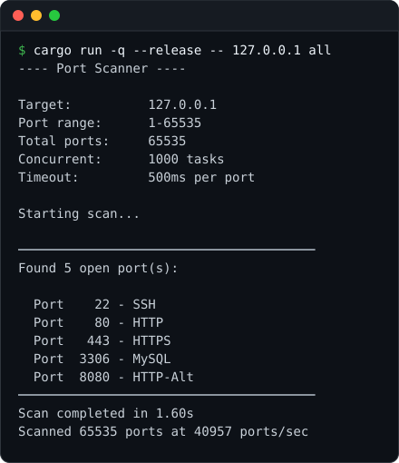
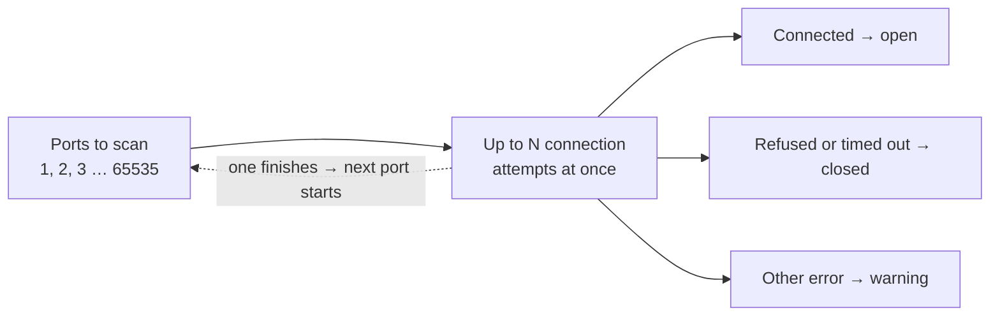

# ⚡Async Port Scanner

A fast, concurrent TCP port scanner written in Rust using async/await and Tokio. It scans all 65,535 ports on localhost in about 1.6 seconds.



<sub>Scanning all ports on localhost, with test listeners running on 22, 80, 443, 3306 and 8080.</sub>

## 🚀 Features

- **Scan any range**: a single range, all 65,535 ports, or the `common` shortcut for 1-1000
- **Async/Await**: keeps up to N connection attempts in flight with Tokio, with no thread per port
- **Flexible Configuration**: set the timeout and concurrency yourself, or use the `fast` preset
- **Honest results**: ports that couldn't be checked (for example "Too many open files") are reported as a warning instead of being quietly counted as closed
- **Port names**: shows the usual service for well-known ports (SSH, HTTP, MySQL, ...)
- **IPv4 and IPv6** targets

## 📋 Prerequisites

- Rust 1.85 or higher (the project uses the 2024 edition)
- Cargo (comes with Rust)

## 🔧 Installation

```bash
# Clone the repository
git clone https://github.com/rusty407/portscanner-in-rust.git
cd portscanner-in-rust

# Build the project
cargo build --release
```

Always scan with `--release`. A debug build takes almost 3x longer (4.5s vs 1.6s for a full localhost scan).

## 🎯 Usage

### Command Format

```
cargo run --release -- <target_ip> <start_port> <end_port> [timeout_ms] [concurrent_limit]
cargo run --release -- <target_ip> all|common [fast]
```

**Arguments:**

| Argument | Meaning | Default |
|----------|---------|---------|
| `target_ip` | IPv4 or IPv6 address (hostnames aren't supported yet) | required |
| `start_port` | First port to scan (1-65535) | required |
| `end_port` | Last port to scan (1-65535) | required |
| `timeout_ms` | How long to wait for each port to answer, in milliseconds | 500 |
| `concurrent_limit` | How many connection attempts run at the same time | 1000 |

**Shortcuts:**
- `all`: scan ports 1-65535
- `common`: scan ports 1-1000
- `fast`: 50ms timeout and 15,000 concurrent. Works after `all`, `common` or a port range, and overrides any timeout or concurrency you gave.

`all` and `common` can't be combined with a custom timeout or concurrency. Use the full form instead, e.g. `1 65535 200 2000`.

### Examples

```bash
# Scan ports 1-1000
cargo run --release -- 127.0.0.1 1 1000

# Scan all ports
cargo run --release -- 192.168.1.1 all

# All ports with a 200ms timeout and 2000 connections at once
cargo run --release -- 192.168.1.1 1 65535 200 2000

# Fast preset (raise the open-file limit first, see Troubleshooting)
ulimit -n 65535
cargo run --release -- 192.168.1.1 all fast

# IPv6
cargo run --release -- ::1 1 1000
```

## 📊 Performance

Measured scanning all 65,535 ports on localhost (Linux, release build):

| Configuration | Time | Ports/sec |
|--------------|------|-----------|
| Default (1000 concurrent, 500ms) | ~1.6s | ~41,000 |
| `fast` (15,000 concurrent, 50ms) | ~1.6s | ~41,000 |

Localhost answers every port instantly, so the timeout never kicks in and both settings finish in about the same time.

Remote hosts are different. If a firewall silently drops packets, every filtered port waits the full timeout. A rough worst case is:

```
time ≈ ports ÷ concurrent_limit × timeout
```

For example, 65,535 filtered ports with the defaults: 65535 ÷ 1000 × 0.5s ≈ **33 seconds**.

*Performance varies based on network conditions, target responsiveness, and system resources.*

## 🛠️ How It Works

This is a **TCP connect scan**: for each port the scanner tries to open a normal TCP connection.



- **Connected**: something is listening, so the port is **open**
- **Connection refused**: the host answered "nothing here", so the port is **closed**
- **No answer before the timeout**: the port is closed, or a firewall is dropping the packets
- **Any other error**: the port wasn't really checked, so it's counted and reported in a warning

### Why It's Fast

- **Sliding window, no batches**: a `FuturesUnordered` holds up to `concurrent_limit` connection attempts. As soon as one finishes, the next port starts, so the scanner never waits for a whole batch to complete.
- **No thread per port**: every attempt is a future polled by Tokio, so thousands of connections in flight cost very little memory.

### Localhost detail

When you scan localhost, the kernel sometimes picks the port being scanned as the connection's own source port, and the socket connects to itself. The scanner detects this and ignores it. Without that check, random high ports show up as fake "open" ports.

## ⚙️ Configuration

### Adjusting Speed vs Accuracy

- **Lower timeout**: faster, but slow services may be missed and reported as closed
- **Higher concurrency**: faster, but needs a higher open-file limit and is more likely to trip rate limits or firewalls

The timeout is how long the scanner *waits* for an answer, not how fast it *sends*. If a host answers quickly, the scan runs at full speed whatever the timeout is. To go easier on a target, lower the concurrent limit.

**Quick (local network):**
```bash
cargo run --release -- <target> 1 65535 100 5000
```

**Careful (remote host):**
```bash
cargo run --release -- <target> 1 65535 1000 100
```

## 🔍 Port Names

Open ports on these well-known numbers get a service name. Everything else shows as `Unknown`.

| Port | Service | Port | Service | Port | Service |
|------|---------|------|---------|------|---------|
| 21 | FTP | 80 | HTTP | 3306 | MySQL |
| 22 | SSH | 110 | POP3 | 3389 | RDP |
| 23 | Telnet | 143 | IMAP | 5432 | PostgreSQL |
| 25 | SMTP | 443 | HTTPS | 5900 | VNC |
| 53 | DNS | 445 | SMB | 8080 | HTTP-Alt |

The name comes only from the port number. The scanner doesn't talk to the service, so a web server running on port 22 would still show up as SSH.

## ⚠️ Warnings

- **Permission**: only scan networks you own or have permission to test
- **High concurrency** needs a higher open-file limit and may trigger rate limits, firewalls or intrusion detection
- **Short timeouts** (under ~100ms on remote hosts) may miss slow-responding services
- **Scan order**: ports are scanned in order (1, 2, 3, ...), which is easy for intrusion detection to spot

## 🐛 Troubleshooting

### "WARNING: N port(s) could not be scanned"

```
WARNING: 3165 port(s) could not be scanned, results may be incomplete.
   First error (port 472): Too many open files (os error 24)
   If it says "Too many open files", lower the concurrent limit or run `ulimit -n 65535` first.
```

Every connection attempt uses a file descriptor, and many systems limit a program to 1024 of them (256 on macOS). For a concurrent limit above about 1000, including `fast`, raise the limit first:
```bash
ulimit -n 65535
```
This only lasts for the current shell.

### Scan seems slow
- Make sure you're running a `--release` build
- Filtered ports wait the full timeout, so lower the timeout or raise the concurrent limit (see the formula under Performance)
- Ensure no firewall is rate-limiting you

### Missing open ports
- Increase timeout (some services respond slowly)
- Reduce concurrent limit (may overwhelm target)
- Check if target has rate limiting

## 🗺️ Roadmap

- [ ] Hostnames as targets (e.g. `scanme.nmap.org`)
- [ ] Port lists like `22,80,443,8000-9000`
- [ ] Rate limit option (`--rate`) and random port order
- [ ] JSON / CSV output
- [ ] Banner grabbing to identify services
- [ ] Scanning whole subnets (`192.168.1.0/24`)

## 🤝 Contributing

Contributions are welcome! Feel free to:

- Report bugs
- Suggest features
- Submit pull requests
- Improve documentation

## 📄 License

This project is licensed under the MIT License - see the [LICENSE](LICENSE) file for details.

## ⚖️ Legal Disclaimer

This tool is provided for educational and ethical testing purposes only. Users are responsible for complying with applicable laws and regulations. Only scan networks and systems you own or have explicit permission to test. Unauthorized port scanning may be illegal in your jurisdiction.

## 🙏 Acknowledgments

Built with:
- [Tokio](https://tokio.rs/) - Async runtime for Rust
- [Futures](https://github.com/rust-lang/futures-rs) - Async abstractions

Credits: Sponjibob & CupMister - helped a lot

## 📬 Contact

Questions? Issues? Feel free to open an issue on GitHub!

---

**⭐ If you find this useful, please star the repository!**
