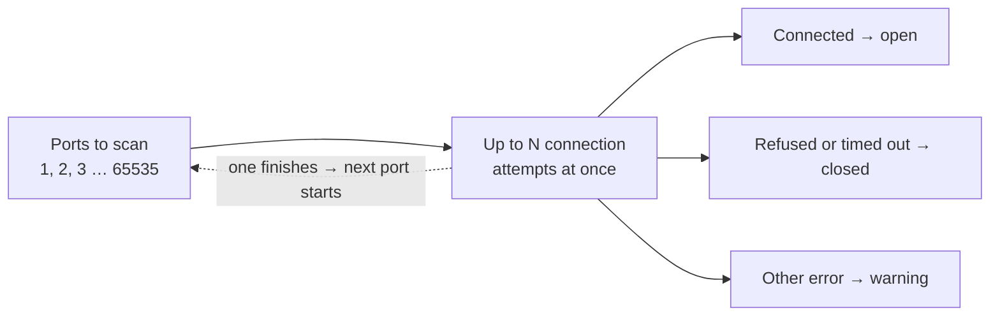

# ⚡Async Port Scanner

A fast, concurrent TCP port scanner written in Rust using async/await and Tokio. It scans all 65,535 ports on localhost in about 1.6 seconds.


<sub>Scanning all ports on localhost, with test listeners running on 22, 80, 443, 3306 and 8080.</sub>

## 🚀 Features

- **Scan any ports**: all 65,535, the `common` shortcut for 1-1000, or a list like `22,80,443,8000-9000`
- **Async/Await**: keeps up to N connection attempts in flight with Tokio, with no thread per port
- **Rate limiting**: `--rate` caps how many connections start per second, to go easy on a target
- **Random order**: `--shuffle` scans ports in random order instead of 1, 2, 3, ...
- **Flexible Configuration**: set the timeout and concurrency yourself, or use the `--fast` preset
- **Honest results**: ports that couldn't be checked (for example "Too many open files") are reported as a warning instead of being quietly counted as closed
- **Port names**: shows the usual service for well-known ports (SSH, HTTP, MySQL, ...)
- **IPv4 and IPv6** targets

## 📋 Prerequisites

- Rust 1.85 or higher (the project uses the 2024 edition)
- Cargo (comes with Rust)

## 🔧 Installation

```bash
# Clone the repository
git clone https://github.com/rusty407/portscanner-in-rust.git
cd portscanner-in-rust

# Build the project
cargo build --release
```

Always scan with `--release`. A debug build takes almost 3x longer (4.5s vs 1.6s for a full localhost scan).

## 🎯 Usage

### Command Format

```
cargo run --release -- <TARGET> [OPTIONS]
```

`<TARGET>` is an IPv4 or IPv6 address. Hostnames aren't supported yet.

**Options:**

| Option | Meaning | Default |
|--------|---------|---------|
| `-p, --ports <PORTS>` | `all`, `common` (1-1000), or a list of ports and ranges like `22,80,8000-9000` | `common` |
| `-t, --timeout <MS>` | How long to wait for each port to answer, in milliseconds | 500 |
| `-c, --concurrency <N>` | How many connection attempts run at the same time | 1000 |
| `-r, --rate <N>` | Start at most N connections per second | no limit |
| `-s, --shuffle` | Scan ports in random order | off |
| `--fast` | Preset: 50ms timeout and 15,000 at once. Can't be combined with `-t` or `-c` | off |
| `-h, --help` | Show all options | |

### Examples

```bash
# Scan ports 1-1000
cargo run --release -- 127.0.0.1

# Scan all ports
cargo run --release -- 192.168.1.1 -p all

# Only some ports
cargo run --release -- 192.168.1.1 -p 22,80,443,8000-9000

# All ports with a 200ms timeout and 2000 connections at once
cargo run --release -- 192.168.1.1 -p all -t 200 -c 2000

# Gentle scan: at most 100 connections per second, in random order
cargo run --release -- 192.168.1.1 -p all -r 100 -s

# Fast preset (raise the open-file limit first, see Troubleshooting)
ulimit -n 65535
cargo run --release -- 192.168.1.1 -p all --fast

# IPv6
cargo run --release -- ::1
```

## 📊 Performance

Measured scanning all 65,535 ports on localhost (Linux, release build):

| Configuration | Time | Ports/sec |
|--------------|------|-----------|
| Default (1000 concurrent, 500ms) | ~1.6s | ~41,000 |
| `--fast` (15,000 concurrent, 50ms) | ~1.6s | ~41,000 |

Localhost answers every port instantly, so the timeout never kicks in and both settings finish in about the same time.

Remote hosts are different. If a firewall silently drops packets, every filtered port waits the full timeout. A rough worst case is:

```
time ≈ ports ÷ concurrency × timeout
```

For example, 65,535 filtered ports with the defaults: 65535 ÷ 1000 × 0.5s ≈ **33 seconds**.

With `--rate`, the scan takes at least `ports ÷ rate` seconds. For example, `-p all -r 500` takes over 2 minutes. The scanner prints this estimate before it starts.

*Performance varies based on network conditions, target responsiveness, and system resources.*

## 🛠️ How It Works

This is a **TCP connect scan**: for each port the scanner tries to open a normal TCP connection.



- **Connected**: something is listening, so the port is **open**
- **Connection refused**: the host answered "nothing here", so the port is **closed**
- **No answer before the timeout**: the port is closed, or a firewall is dropping the packets
- **Any other error**: the port wasn't really checked, so it's counted and reported in a warning

### Why It's Fast

- **Sliding window, no batches**: a `FuturesUnordered` holds up to `--concurrency` connection attempts. As soon as one finishes, the next port starts, so the scanner never waits for a whole batch to complete.
- **No thread per port**: every attempt is a future polled by Tokio, so thousands of connections in flight cost very little memory.

### Rate limiting

With `--rate N`, each connection gets a start time at least `1/N` seconds after the previous one, and waits for it before connecting. If the scan falls behind (for example while waiting on slow ports), it carries on from "now" instead of firing a burst to catch up, so the rate is never exceeded.

### Localhost detail

When you scan localhost, the kernel sometimes picks the port being scanned as the connection's own source port, and the socket connects to itself. The scanner detects this and ignores it. Without that check, random high ports show up as fake "open" ports.

## ⚙️ Configuration

### Adjusting Speed vs Accuracy

- **Lower timeout** (`-t`): faster, but slow services may be missed and reported as closed
- **Higher concurrency** (`-c`): faster, but needs a higher open-file limit and is more likely to trip rate limits or firewalls

### Avoiding getting blocked

The timeout is how long the scanner *waits* for an answer, not how fast it *sends*. If a host answers quickly, the scan runs at full speed whatever the timeout is. To go easy on a target:

- **`--rate`** caps connections per second. This is the main setting to use.
- **`--shuffle`** avoids the 1, 2, 3, ... pattern that intrusion detection looks for.

**Quick (local network):**
```bash
cargo run --release -- <target> -p all -t 100 -c 5000
```

**Careful (remote host):**
```bash
cargo run --release -- <target> -p all -t 1000 -r 100 -s
```

## 🔍 Port Names

Open ports on these well-known numbers get a service name. Everything else shows as `Unknown`.

| Port | Service | Port | Service | Port | Service |
|------|---------|------|---------|------|---------|
| 21 | FTP | 80 | HTTP | 3306 | MySQL |
| 22 | SSH | 110 | POP3 | 3389 | RDP |
| 23 | Telnet | 143 | IMAP | 5432 | PostgreSQL |
| 25 | SMTP | 443 | HTTPS | 5900 | VNC |
| 53 | DNS | 445 | SMB | 8080 | HTTP-Alt |

The name comes only from the port number. The scanner doesn't talk to the service, so a web server running on port 22 would still show up as SSH.

## ⚠️ Warnings

- **Permission**: only scan networks you own or have permission to test
- **High concurrency** needs a higher open-file limit and may trigger rate limits, firewalls or intrusion detection. Use `--rate` to slow down.
- **Short timeouts** (under ~100ms on remote hosts) may miss slow-responding services
- **Scan order**: by default ports are scanned in order (1, 2, 3, ...), which is easy for intrusion detection to spot. Use `--shuffle` to randomize it.

## 🐛 Troubleshooting

### "WARNING: N port(s) could not be scanned"

```
WARNING: 3165 port(s) could not be scanned, results may be incomplete.
   First error (port 472): Too many open files (os error 24)
   If it says "Too many open files", lower the concurrent limit or run `ulimit -n 65535` first.
```

Every connection attempt uses a file descriptor, and many systems limit a program to 1024 of them (256 on macOS). For `-c` above about 1000, including `--fast`, raise the limit first:
```bash
ulimit -n 65535
```
This only lasts for the current shell.

### Scan seems slow
- Make sure you're running a `--release` build
- If you set `--rate`, that's the speed limit: the scan takes at least `ports ÷ rate` seconds
- Filtered ports wait the full timeout, so lower `-t` or raise `-c` (see the formula under Performance)
- Ensure no firewall is rate-limiting you

### Missing open ports
- Increase the timeout (`-t`), since some services respond slowly
- Lower the concurrency (`-c`) or set a `--rate`, since you may be overwhelming the target
- Check if target has rate limiting

## 🗺️ Roadmap

- [x] Port lists like `22,80,443,8000-9000`
- [x] Rate limit option (`--rate`) and random port order (`--shuffle`)
- [ ] Hostnames as targets (e.g. `scanme.nmap.org`)
- [ ] JSON / CSV output
- [ ] Banner grabbing to identify services
- [ ] Scanning whole subnets (`192.168.1.0/24`)

## 🤝 Contributing

Contributions are welcome! Feel free to:

- Report bugs
- Suggest features
- Submit pull requests
- Improve documentation

## 📄 License

This project is licensed under the MIT License - see the [LICENSE](LICENSE) file for details.

## ⚖️ Legal Disclaimer

This tool is provided for educational and ethical testing purposes only. Users are responsible for complying with applicable laws and regulations. Only scan networks and systems you own or have explicit permission to test. Unauthorized port scanning may be illegal in your jurisdiction.

## 🙏 Acknowledgments

Built with:
- [Tokio](https://tokio.rs/) - Async runtime for Rust
- [Futures](https://github.com/rust-lang/futures-rs) - Async abstractions
- [clap](https://github.com/clap-rs/clap) - Command-line argument parsing
- [fastrand](https://github.com/smol-rs/fastrand) - Random port order

Credits: Sponjibob & CupMister - helped a lot

## 📬 Contact

Questions? Issues? Feel free to open an issue on GitHub!

---

**⭐ If you find this useful, please star the repository!**
